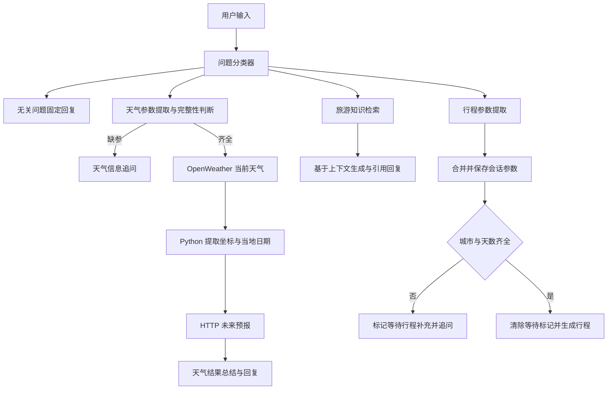
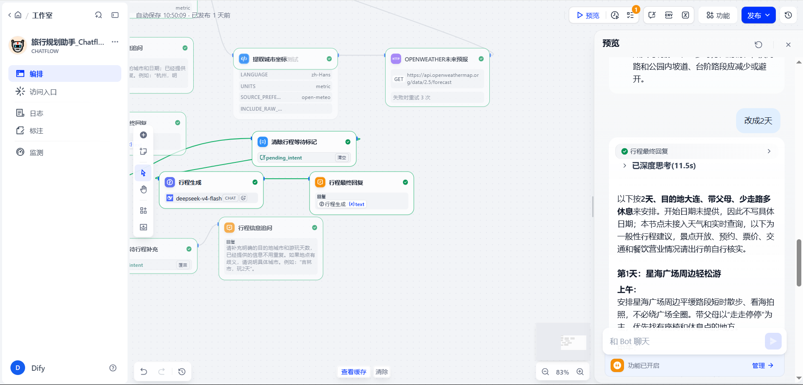

# AI Travel Agent · Dify 旅行规划助手

基于 Dify 的旅行助手学习项目：从单 Agent 演进到显式分支的 Chatflow，实践知识库检索、外部天气 API、结构化参数提取和多轮行程参数保存。

**当前进度：按 14 步计划完成了第 1–11 步（Chatflow 搭建、知识库、天气接口、多轮行程参数保存）。完整评测尚未执行，因此本项目不提供通过率。**

## 已实现的功能

| 能力 | 实现方式 | 当前边界 |
| --- | --- | --- |
| 意图分流 | 问题分类器区分天气、知识问答、旅游规划、无关问题 | 等待行程补充时，使用 `pending_intent` 辅助路由 |
| 三城知识问答 | 沈阳、大连、天津，共 9 份文档；知识检索 → LLM → 引用回答 | 未收录事实应说明缺失，不能把标题当作答案 |
| 天气与未来预报 | OpenWeather 当前天气 → Python 提取坐标 → HTTP `/data/2.5/forecast` | 受接口返回时间范围限制；天气多轮补参尚未实现 |
| 多轮行程规划 | 参数提取、Python 合并、会话变量保存、缺参追问 | 支持补充城市/天数及更新天数；新任务状态隔离仍需加强 |
| 输出约束 | 区分资料事实与一般建议，限制编造动态票务/房价 | 行程生成目前未接入知识检索或天气查询 |

## 工作流

## 复现入口

1. 下载 [当前 Chatflow YAML](v3-chatflow.yml)，在 Dify 工作室导入；也提供 [应用包](exports/v3-chatflow.ifpkg)。
2. 按 [配置与复现指南](docs/SETUP.md) 设置模型、插件、自己的 OpenWeather Key，并重新绑定知识库。
3. 先执行指南中的冒烟验证，再使用 [57 条评测用例](evaluation/cases.csv) 做人工或后续 API 回归。

导出模板已清空环境变量值、会话初值和原工作区知识库绑定，不能直接导入后零配置运行。模型名称及 Dify 导出格式可能需要适配你的环境。

当前知识问答仅依据检索资料，库外城市或未收录事实应说明资料缺失；行程分支可以提供明确标注的一般建议。57 题尚未完整执行；D001 标注已知限制，D005/D006 的天气项按当前范围注明不判定。范围注释不代表这些用例已通过。当前状态见 [迭代日志](docs/ITERATION_LOG.md)。

## 已有验证与证据

行程可以先提出“大连带父母玩、少走路”，再补充天数，并在后续修改为 2 天：

截图是本项目当时的交互记录，日期和天气数值不代表当前天气。更多边界见 [已知问题](docs/KNOWN_ISSUES.md)。

检索实验有 3 组 × 15 题的人工记录。10 道有答案题中，A/B/C 的答案片段召回分别为 6/10、6/10、8/10；C 的 Top K 同时从 3 改为 5，不能把差异单独归因于重排模型。详见 [评测说明](docs/EVALUATION.md)。

## 文件说明

| 路径 | 内容 |
| --- | --- |
| `v3-chatflow.yml` | 脱敏后的当前 Chatflow 模板 |
| `knowledge/` | 当前三城九份知识文档，包含来源与适用范围 |
| `scripts/` | 模板中的两个 Python 节点源码 |
| `evaluation/` | 42 条基础用例 + 15 条 RAG 用例；不是已通过结果 |
| `tests/` | 本地节点逻辑检查，不调用付费模型或天气接口 |
| `docs/` | 配置、评测口径、已知问题 |
| `travel-agent.yml` | 原仓库早期单 Agent 历史版本，保留用于追溯 |

原有 `images/首页图.png`、`images/效果图1.png`、`images/效果图2.png` 及根目录北京/东北攻略继续保留为早期素材；当前 Chatflow 的知识源是 `knowledge/` 中的九份文档。原始单 Agent 导出不是与当前 Chatflow 严格同条件的实验基线。

## 技术实践

- Dify Chatflow 的意图分类、条件分支和显式工具编排。
- RAG 分块与重叠、向量/混合检索、Top K、重排及人工召回分析。
- HTTP API 参数绑定、Secret 环境变量、JSON 解析和动态城市坐标传递；借助 AI 编写 Python 节点，并对关键合并逻辑做离线测试。
- 会话状态管理、缺参追问、参数合并与多轮任务路由。
- 结合用例与可核验轨迹记录天气误路由、检索对象混淆及代码返回分支等问题；缺少证据的原因保留为待核验。

这些是项目实践内容，不代表已完成生产部署、模型训练或高并发验证。更新细节见 [变更记录](CHANGELOG.md)。
